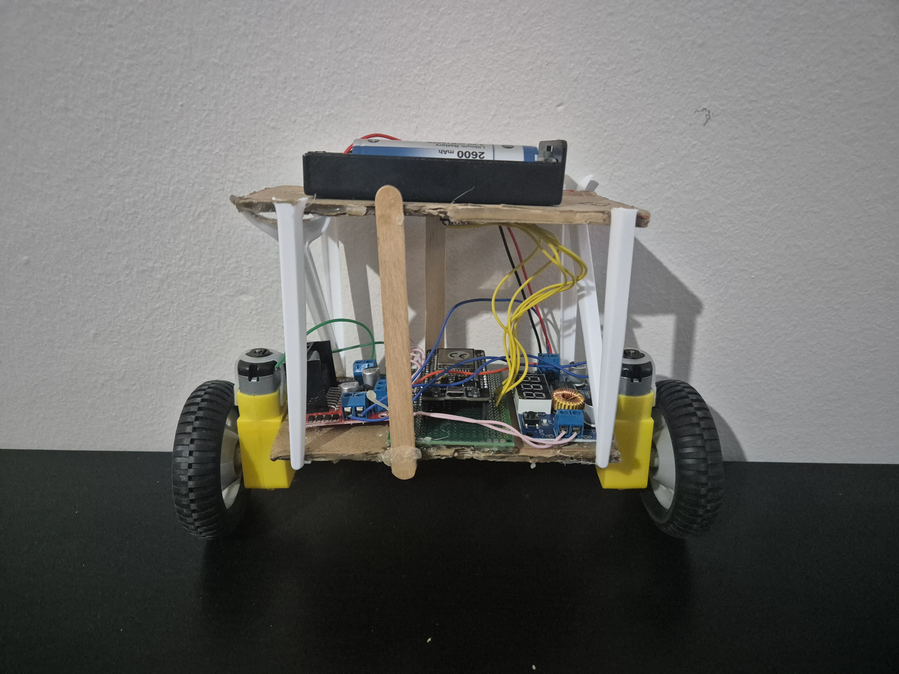
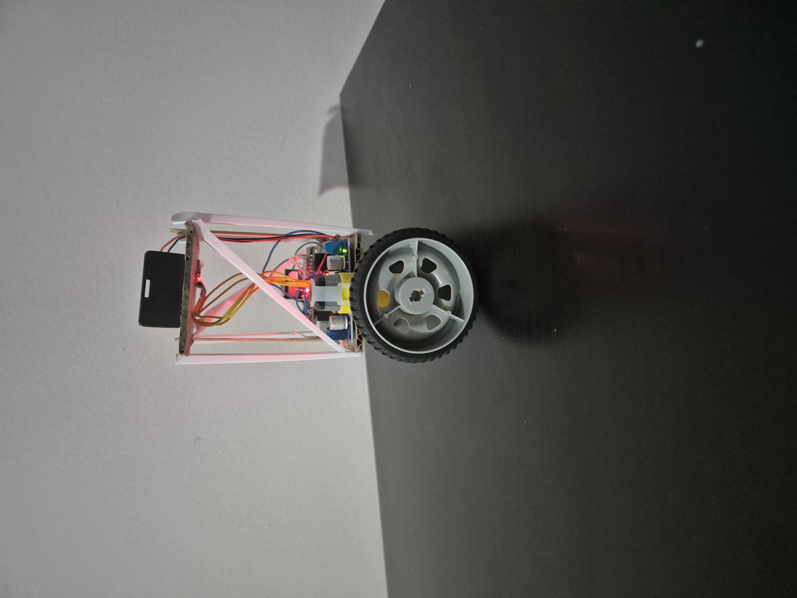
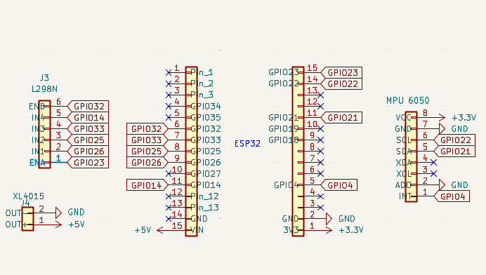
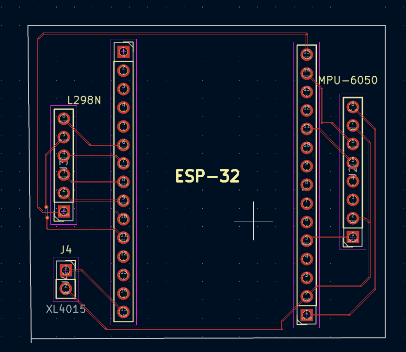

# ESP32 Self-Balancing Robot — Prototype

## Overview

An experimental two-wheeled self-balancing robot prototype developed using an ESP32 microcontroller, an MPU6050 inertial measurement unit (IMU), and an L298N motor driver.

The project focuses on embedded systems, hardware integration, sensor interfacing, motor control, and feedback control.

**Project Status: Work in Progress**

The hardware prototype has been assembled and tested. An experimental PID-based balancing controller has been implemented; however, reliable autonomous balancing has not yet been achieved.

## Hardware Prototype

The robot was assembled using a custom-built chassis and commercially available electronic modules.

### Front View

### Side View

## Hardware Components

- ESP32 DevKit V1
- MPU6050 (GY-521) IMU
- L298N dual motor driver
- Two DC geared motors with wheels
- Two 18650 lithium-ion batteries
- XL4015 DC-DC buck converter
- Custom-built prototype chassis

## Implemented Features

- MPU6050 communication via I2C
- Accelerometer and gyroscope data acquisition
- Tilt angle estimation using a complementary filter
- Bidirectional DC motor control using PWM
- Experimental PID-based balancing controller
- Tilt-angle safety cutoff
- Serial monitoring for debugging and controller tuning

## Circuit Design & PCB Layout

The circuit schematic and a preliminary two-layer PCB layout were designed using KiCad.

The PCB design is intended for documentation and learning purposes. It has not been manufactured or physically validated.

### Circuit Schematic

### PCB Layout

## Current Limitations

The robot responds to changes in tilt angle but does not yet maintain stable, sustained autonomous balance.

The current implementation requires further improvements in control stability, low-speed motor response, and mechanical construction.

## Future Development

- Improve balancing stability and controller tuning
- Refine low-speed motor control
- Improve mechanical rigidity and component mounting
- Investigate wheel-speed feedback using encoders
- Validate and refine the PCB design

## Project Goal

To develop practical skills in embedded systems, sensor fusion, feedback control, electronics integration, PCB design, and iterative prototyping.

To gain practical experience in embedded systems, sensor fusion, feedback control, electronics integration, and iterative prototyping.
